# Assignment 1 - VPC & Networking
 
A custom AWS network built from scratch: one VPC with a public and a private subnet, routing for internet access in both directions, and EC2 instances deployed across them with locked-down security groups. Bonus tasks: a bastion host for reaching the private instance, and CloudWatch alarms with email alerts.
 
## Architecture
 
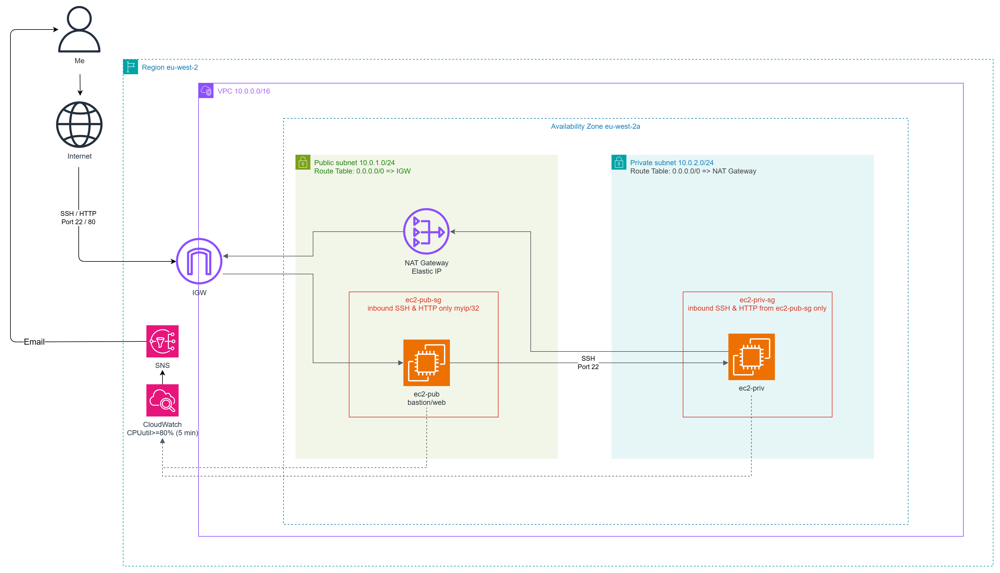
 
| Component | Value |
|---|---|
| Region / AZ | eu-west-2 (London) / eu-west-2a |
| VPC | hamzah-custom-vpc, 10.0.0.0/16 |
| Public subnet | 10.0.1.0/24 |
| Private subnet | 10.0.2.0/24 |
| Internet gateway | hamzah-custom-igw, attached to the VPC |
| NAT gateway | In the public subnet, with an Elastic IP |
| Public route table | 0.0.0.0/0 → IGW, 10.0.0.0/16 → local |
| Private route table | 0.0.0.0/0 → NAT gateway, 10.0.0.0/16 → local |
| ec2-pub | t3.micro, Amazon Linux 2023, 10.0.1.231, public IP, web server and bastion |
| ec2-priv | t3.micro, Amazon Linux 2023, 10.0.2.245, no public IP |
| ec2-pub-sg | Inbound SSH (22) and HTTP (80) from my IP (/32) only |
| ec2-priv-sg | Inbound SSH (22) and HTTP (80) from ec2-pub-sg only |
| Monitoring | CloudWatch CPU alarms on both instances → SNS topic → email |
 
## What I built
 
### 1. VPC and subnets
A VPC with a 10.0.0.0/16 range, split into a public subnet (10.0.1.0/24) and a private subnet (10.0.2.0/24), both in eu-west-2a. AWS reserves 5 addresses in every subnet (network, VPC router, DNS, one for future use, broadcast), so each /24 gives 251 usable IPs, not 256.
 
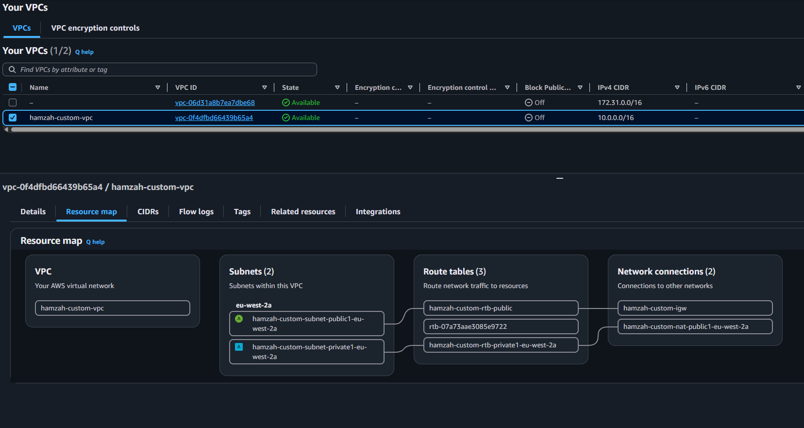
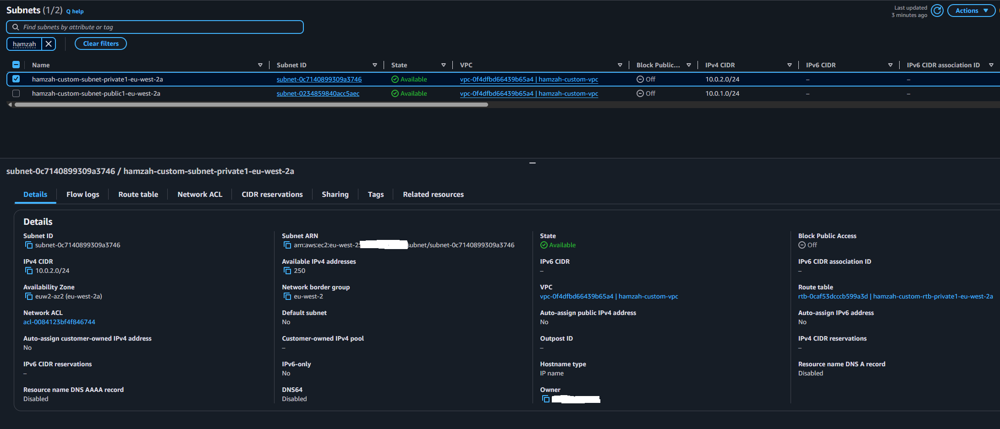
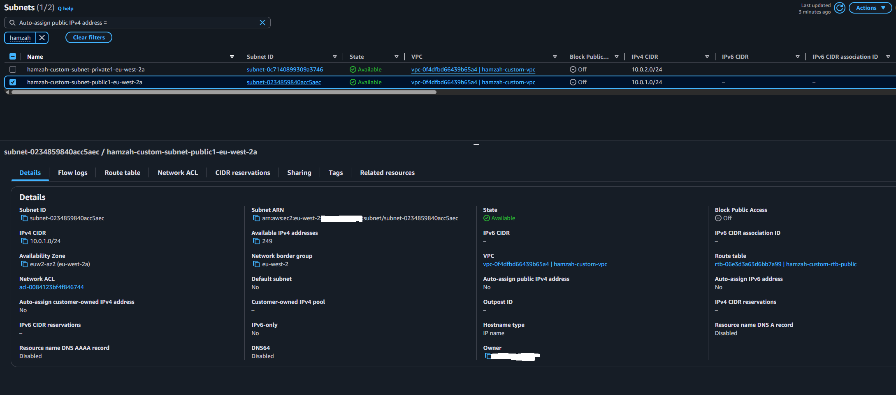
 
### 2. Internet access
- An **internet gateway** attached to the VPC. It's the VPC's only door to the internet.
- A **NAT gateway** in the public subnet with an **Elastic IP**, so instances in the private subnet can reach out to the internet without being reachable from it.
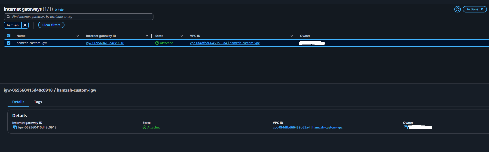
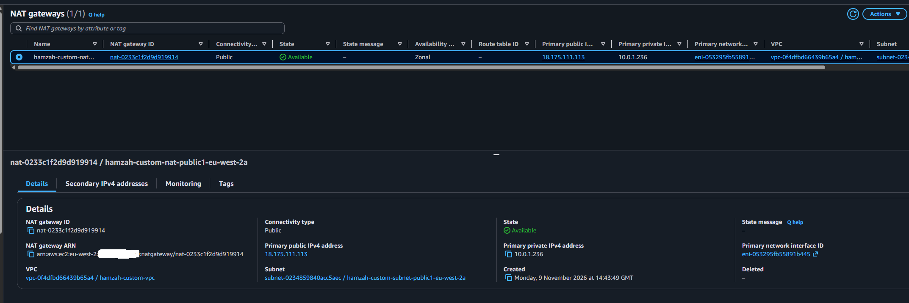
 
### 3. Route tables
A subnet is only "public" because of its route table. There's no public/private switch in AWS.
 
- **Public route table:** 0.0.0.0/0 → internet gateway
- **Private route table:** 0.0.0.0/0 → NAT gateway
Both also have the automatic 10.0.0.0/16 → local route, which is how the two subnets talk to each other. Each subnet is explicitly associated with its own route table, so neither falls back to the VPC's main route table.
 
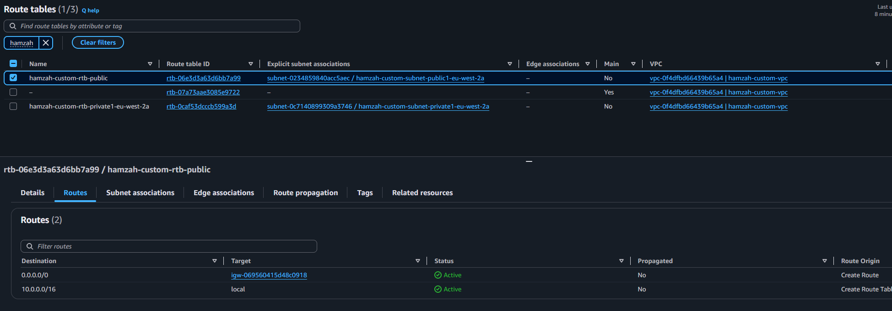
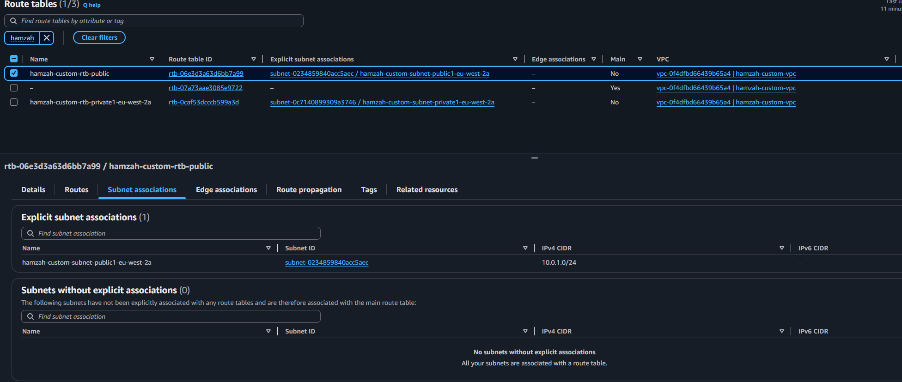
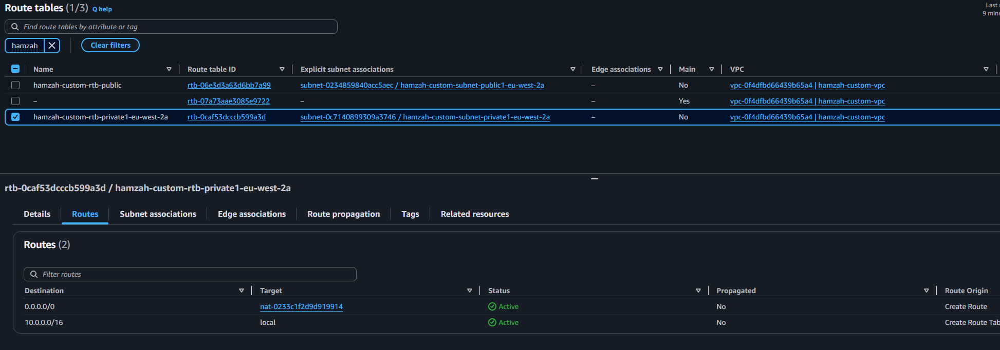
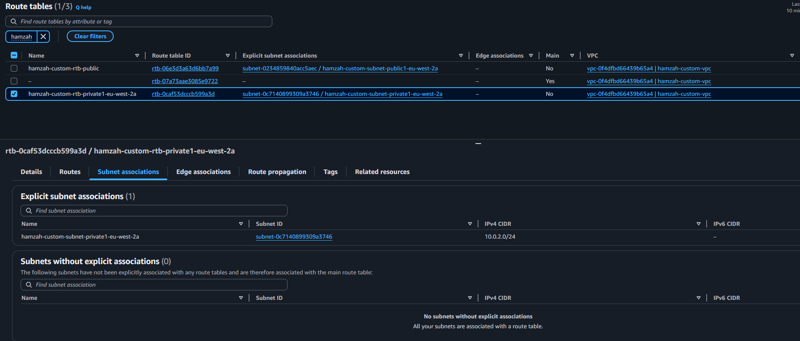
 
### 4. EC2 instances
- **ec2-pub:** launched in the public subnet with a public IP, running Apache from a user data script.
- **ec2-priv:** launched in the private subnet with no public IP.
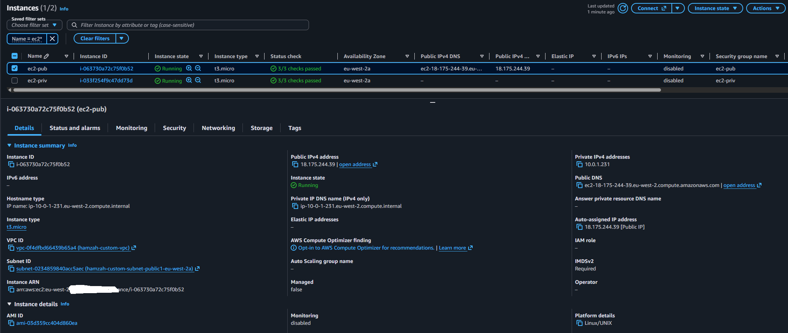
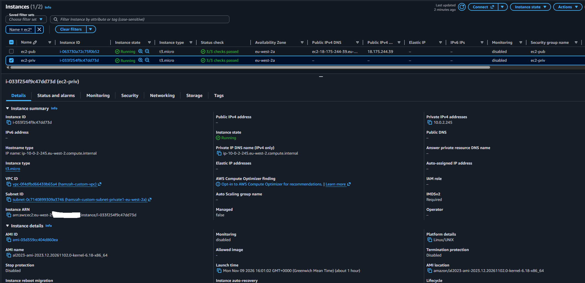
 
User data for the web server (runs once, as root, on first boot):
 
```bash
#!/bin/bash
yum update -y
yum install -y httpd
systemctl enable --now httpd
echo "<h1>Welcome to $(hostname -f) user!</h1>" > /var/www/html/index.html
```
 
### 5. Security groups
- **ec2-pub-sg:** SSH and HTTP from my IP only.
- **ec2-priv-sg:** SSH and HTTP only from instances in ec2-pub-sg. The source is a security group, not an IP range, so the rule still works if the public instance's IP changes.
Security groups are stateful, so reply traffic is allowed back automatically. That's why the private instance needs no inbound rule for its NAT traffic.
 
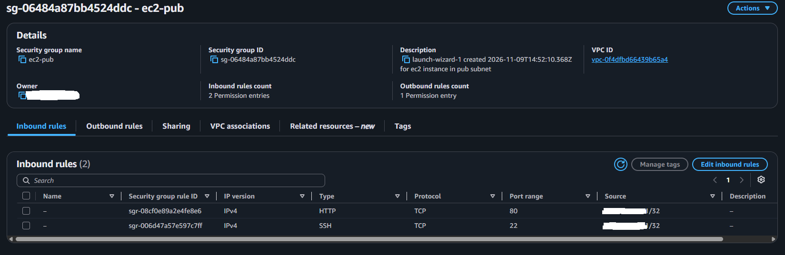
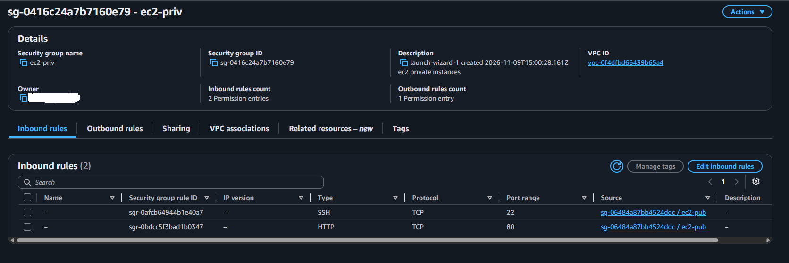
 
## Testing
 
**Web server works from my IP:**
 
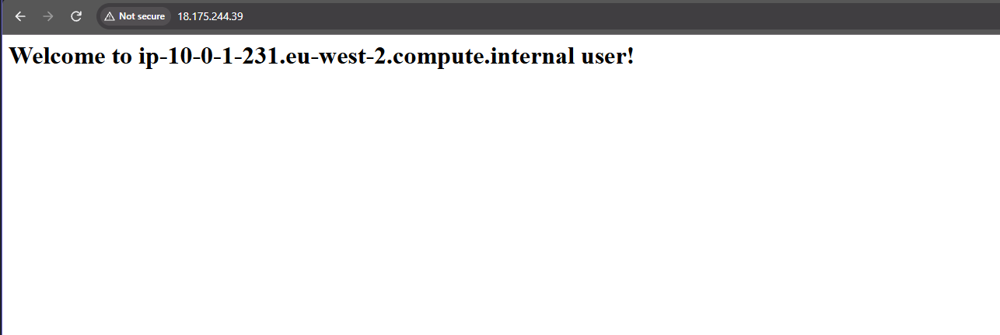
 
**...and is blocked from anywhere else.** The same URL on my phone over 5G (a different IP) times out, which proves HTTP is restricted to my IP rather than open to the world:
 
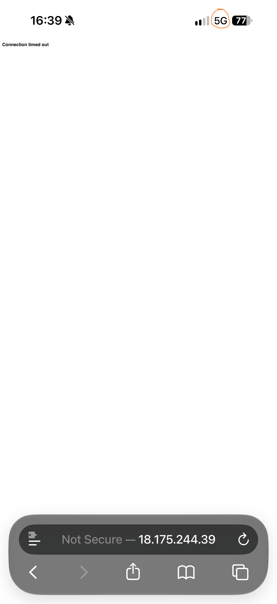
 
**SSH into the private instance through the bastion.** The prompt shows ip-10-0-2-245, so I'm on the private instance:
 
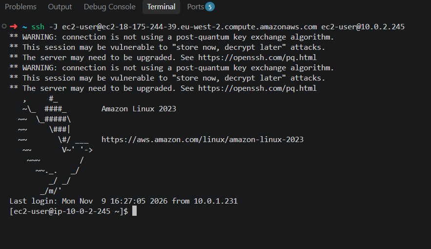
 
**The private instance can reach the internet through the NAT gateway**, despite having no public IP:
 
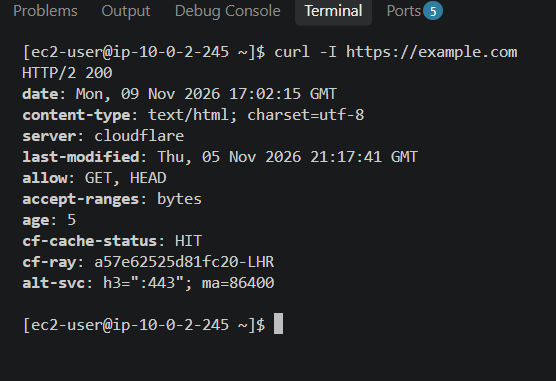
 
**The internet sees the private instance as the NAT gateway's Elastic IP.** checkip.amazonaws.com returned the same IP as the NAT's Elastic IP in the console:
 
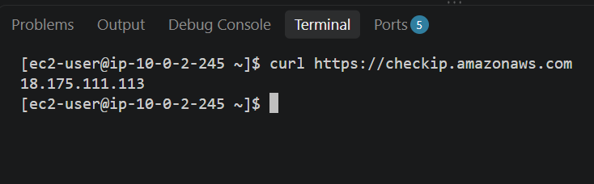
 
## Bonus
 
### Bastion host
ec2-pub acts as the bastion: it's the only route into the private subnet, because ec2-priv-sg only accepts SSH from it.
 
I connected using **ProxyJump**, so my private key never leaves my laptop:
 
```bash
eval "$(ssh-agent -s)"
ssh-add ~/.ssh/<key>.pem
ssh -J ec2-user@<bastion-public-dns> ec2-user@10.0.2.245
```
 
I chose this over copying the .pem onto the bastion, where anyone who compromised the bastion would get the key to everything behind it. I also chose it over agent forwarding (ssh -A), where root on the bastion could use my key while I'm connected.
 
### CloudWatch monitoring
- A CPUUtilization alarm on each instance: **≥ 80% for 1 datapoint within 5 minutes**.
- Both alarms notify an SNS topic, which emails me.
- To test it, I maxed out the private instance's CPU with yes > /dev/null. A t3.micro has 2 vCPUs and CPUUtilization is averaged across them, so one process only reaches about 50%. I needed two to cross 80%.
The alarm fired at 99.98% and sent the email, then returned to OK once the load stopped:
 
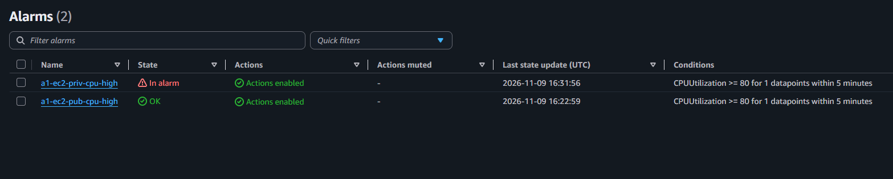
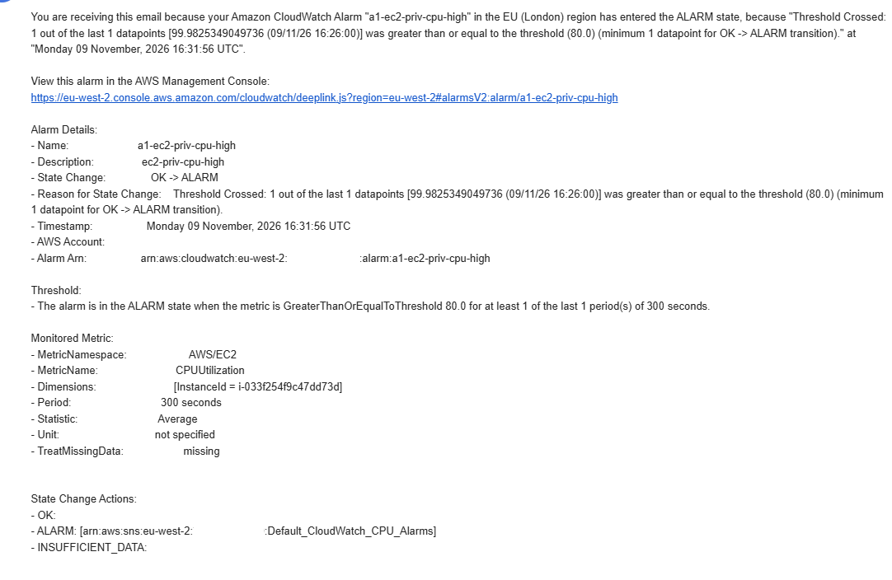
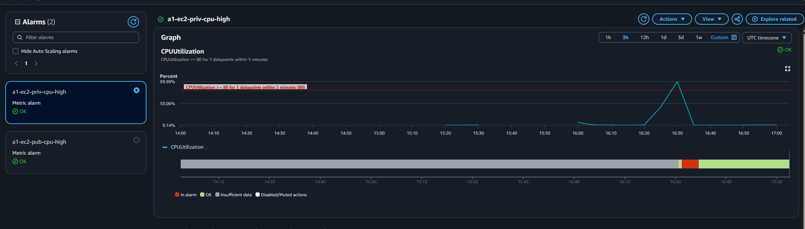
 
The private instance has metrics even with no public IP, because basic EC2 metrics are collected by AWS from the hypervisor, not sent out over my network. Memory and disk usage aren't in the default metrics; they'd need the CloudWatch agent installed on the instance.
 
## Challenges and how I solved them
 
| Problem | Cause | Fix |
|---|---|---|
| Launched the private instance without a key pair | A key pair can only be set at launch. Without one, authorized_keys is empty and password login is disabled | Terminated it and relaunched with the same key pair as ec2-pub |
| "Identity file not accessible" when SSHing | A relative key path from the wrong directory | Used the full path to the key in ~/.ssh |
| ssh -J failed with Permission denied on the bastion | -i only applies to the final host. The jump connection never received my key | Loaded the key into ssh-agent so both hops could use it |
| The private alarm sat on "Insufficient data" | I'd picked the CPU metric of the terminated keyless instance, which had the same name | Matched the alarm's InstanceId to the running instance. CloudWatch tracks resources by ID, not name |
| SSH became unresponsive during the CPU test | Both vCPUs at 100%, so sshd was starved of CPU | Rebooted the instance. Next time I'll use timeout 600 yes > /dev/null so the load stops itself |
| User data would have silently failed | yum install httpd without -y waits for a "y" that never comes | Added -y. If user data doesn't seem to work, the log is at /var/log/cloud-init-output.log |
 
## What I learnt
 
- **Route tables make a subnet public or private.** Same VPC, same building blocks. The only difference is whether 0.0.0.0/0 points at the IGW or the NAT.
- **The NAT gateway lives in the public subnet** and uses the public route table to reach the IGW. That's why it can't serve instances in its own subnet: their traffic goes straight to the IGW.
- **NAT is outbound only.** The private instance can start connections out, but nothing on the internet can start one in. The NAT tracks each connection by port (PAT), so many private instances can share one Elastic IP.
- **The Elastic IP gives the private subnet one fixed public identity,** which external services can allowlist.
- **Security groups see the original source,** not the gateway the traffic passed through. Referencing another security group as the source is cleaner than hard-coding IPs.
- **Reaching a port and logging in are different things.** The security group decides who can reach port 22; the key pair decides who can log in.
- **A bastion is a role, not an AWS product.** It's any instance set up to be the single, locked-down entry point.
- **Prove the negative.** Showing the site *doesn't* load from another network matters as much as showing it loads from mine.
## Trade-offs and what I'd do in production
 
- **Single AZ:** everything is in eu-west-2a, so an AZ outage takes down the whole build. In production I'd use subnets in at least two AZs, with a NAT gateway in each, so private subnets don't depend on another AZ.
- **Bastion doubling as web server:** the web server is the most exposed machine, so it shouldn't also be the SSH gateway. I'd use a separate, minimal bastion, or better, **SSM Session Manager**, which needs no bastion, no open port 22 and no SSH keys, with access controlled by IAM.
- **One key for both instances:** simpler, but one leaked key opens everything. Separate keys, or SSM, limit how much a single leak exposes.
- **HTTP on ec2-priv-sg:** if nothing on the private instance needs port 80, that rule should go (least privilege).
- **Cost:** the NAT gateway and public IPv4 addresses are billed hourly even when idle, so I deleted the NAT gateway and released the Elastic IP after testing.
## Clean-up
 
- Terminated both instances (this also deletes their EBS volumes and public IP)
- Deleted the NAT gateway, then released the Elastic IP (deleting the NAT doesn't release it)
- Deleted the CloudWatch alarms
- Kept the VPC, subnets, IGW, route tables and security groups (free) to reuse in Assignment 2. The private route table's 0.0.0.0/0 route now shows as a **blackhole**, because its NAT target no longer exists.