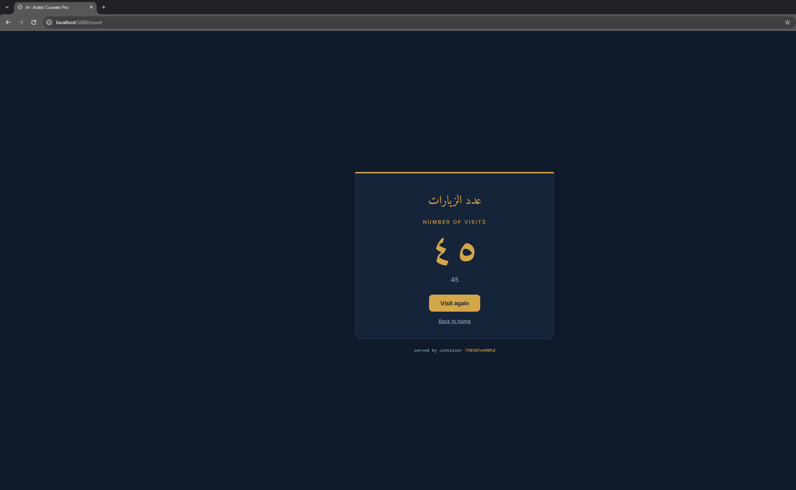

# Arabic Counter Pro
 
A multi-container Docker project: a Flask app that counts visits in Redis, running as three replicas behind an NGINX load balancer, with health-checked startup. Built for the Containers module of the CoderCo DevOps bootcamp, starting from the [containers-intro](https://github.com/codercohq/containers-intro) challenge.
 
As a personal touch, the visit count is shown in Eastern Arabic numerals (٠١٢٣٤٥٦٧٨٩), reflecting my Arabic studies.
 

 
## Architecture
 
```
Browser ──► localhost:5000
               │
               ▼
        ┌─────────────┐
        │    NGINX    │  listens on :80, the only published port (5000:80)
        └──────┬──────┘
               │ proxy_pass http://app:5000 (round-robin)
     ┌─────────┼─────────┐
     ▼         ▼         ▼
 ┌───────┐ ┌───────┐ ┌───────┐
 │ app-1 │ │ app-2 │ │ app-3 │  Flask on :5000, stateless
 └───┬───┘ └───┬───┘ └───┬───┘
     └─────────┼─────────┘
               ▼
        ┌─────────────┐
        │    Redis    │  :6379, data on the redis_data named volume
        └─────────────┘
```
 
All services share Compose's default network and reach each other by service name. Only NGINX publishes a port to the host.
 
## Features
 
- **Flask app** with `/` (welcome page), `/count` (increments and shows the visit count) and `/health`
- **Redis** as a shared key-value store, so all three replicas show one consistent count
- **Persistent storage**: a named volume keeps the count across `docker compose down` / `up`
- **Environment variables**: Redis host and port passed in through `env_file`, with defaults in the code
- **Scaling and load balancing**: three app replicas (`deploy.replicas`) behind NGINX, round-robin
- **Health checks**: Redis is checked with `redis-cli ping` and the app with `wget` against `/health`. Startup order is `redis` → `app` → `nginx` using `condition: service_healthy`
- **Cache-friendly Dockerfile**: dependencies are installed before the app code is copied in
## Running it
 
```bash
cp .env.example .env
docker compose up -d --build
docker compose ps
```
 
Then open:
 
- http://localhost:5000: welcome page
- http://localhost:5000/count: visit counter (refresh to watch it go up and see a different container answer)
- http://localhost:5000/health: health status
To see the load balancing in the logs:
 
```bash
docker compose logs -f app
```
 
To stop it:
 
```bash
docker compose down      # keeps the count
docker compose down -v   # also deletes the Redis volume, so the count resets
```
 
## Project structure
 
```
.
├── app.py               # Flask app: routes, Redis connection, Arabic digit conversion
├── templates/           # Jinja templates (base layout, home page, count page)
├── requirements.txt     # flask, redis
├── Dockerfile           # app image
├── docker-compose.yml   # app (x3), redis, nginx, volume, health checks
├── nginx.conf           # reverse proxy config, mounted read-only into NGINX
├── .env.example         # copy to .env
└── images/              # screenshots for this README
```
 
## Problems I hit and how I fixed them
 
- When pointing the app to redis in the python code, I made the mistake of using localhost:6379 as the redis container address. Within the app container, localhost is the app container itself, so it would fail. I then pointed it to redis which was the service name in the compose file fixing it. 
- Adding env_file to compose: I first did `environment: env_file: .env` then `environment: - .env`
Pointing to a file needs its own key, so I fixed it by putting `env_file: - .env` 
- when adding depends_on in compose.yaml, I put nginx under app , which means the app would wait for nginx to start. What I needed to do is put it the other way round where nginx waits for the app containers to start, because nginx looks up app when it starts, so if no app containers exist nginx would fail to start.
- When I started I had the challenge folder named with brackets in it, later on I decided to remove them. This orphaned the old docker volume which was set to create a default volume using the folder name, so as the folder name changed, Compose created a new empty volume. This is something to think about when working in production.
- In compose.yaml, I mounted ./nginx.conf before I had created the file, resulting in an empty directory being created by Docker with that name. This meant saving to it failed with 'is a directory'. I removed the empty directory with rmdir and created the real file. 
- Writing the commands for the health check, specifically the app container which comes with wget, I incorrectly used the syntax WGET instead of wget which resulted in a failed health check. Linux program names are case-sensitive. I reduced the intervals to 5s as this is closer to a normal container start up time, rather than 90s that I started with.
- In the compose.yaml I wrote the app health check to send wget to localhost:5000/health which resulted in it resolving to the IPv6 loopback ::1 in the app container's /etc/hosts, (the container's resolver ranks it above 127.0.0.1). Flask only listens on IPv4. I then had to change it to 127.0.0.1.
 
## What I learned
 
<!-- Your own words. -->
 
## Screenshots
 
<!-- Add your own: home page, count page, docker compose ps showing (healthy), logs showing round-robin -->