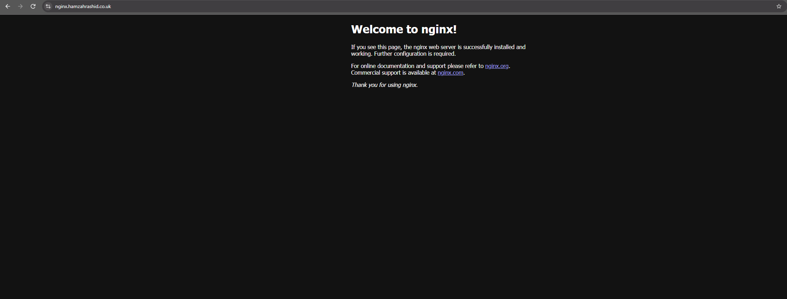
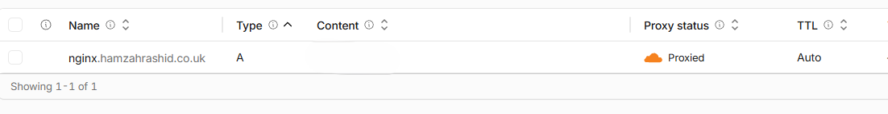
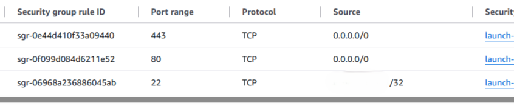
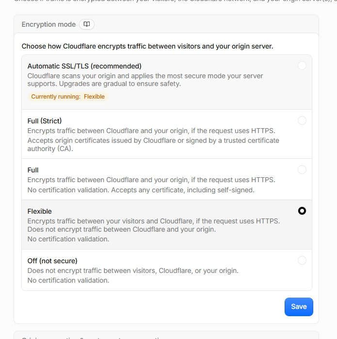

# Networking: Domain + EC2 + DNS
 
## What I built
 
A web server on AWS EC2 running NGINX, reachable from my own domain through Cloudflare DNS.
 
```
Browser
   │  HTTPS (443)
   ▼
Cloudflare (DNS + proxy)
   │  HTTP (80)   ← SSL/TLS mode: Flexible
   ▼
AWS EC2 (Ubuntu) ── Security group: 80, 443 open / 22 my IP only
   │
   ▼
NGINX → default welcome page
```
 
| Component | Details |
|---|---|
| Domain | `hamzahrashid.co.uk`, registered with Cloudflare |
| DNS record | `A` record: `nginx` → EC2 public IPv4 (proxied) |
| Compute | AWS EC2, Ubuntu AMI, region `eu-north-1` (Stockholm) |
| Web server | NGINX 1.28 |
| Firewall | EC2 security group |
 
## How I built it
 
### 1. Launched an EC2 instance
 
- Ubuntu AMI on a small free-tier-eligible instance, using AWS's Free plan so I couldn't be charged
- Created a key pair (`nginx-webserver.pem`) for SSH
- Security group inbound rules:
| Port | Protocol | Source | Why |
|---|---|---|---|
| 22 | TCP | My IP only (`/32`) | SSH, locked to my IP so nobody else can try to log in |
| 80 | TCP | `0.0.0.0/0` | HTTP, needed so Cloudflare can reach NGINX |
| 443 | TCP | `0.0.0.0/0` | HTTPS, opened ready for Full (strict) mode later |
 
### 2. Connected over SSH
 
```bash
ssh -i "C:\Users\Hamzah\.ssh\nginx-webserver.pem" ubuntu@<EC2-public-IP>
```
 
### 3. Installed and started NGINX
 
```bash
sudo apt update
sudo apt upgrade
sudo apt install nginx
sudo systemctl status nginx
```
 
### 4. Checked the config and tested locally
 
```bash
cd /etc/nginx/sites-available
sudo cp default default.copy      # back up before editing
sudo vi default
sudo nginx -t                     # test the config for syntax errors
sudo systemctl reload nginx
curl localhost                    # does NGINX answer on the server itself?
sudo ss -tlnp                     # which ports are listening?
```
 
### 5. Created the DNS record in Cloudflare
 
| Type | Name | Content | Proxy |
|---|---|---|---|
| A | `nginx` | EC2 public IPv4 | Proxied |
 
### 6. Tested in a browser
 
`nginx.hamzahrashid.co.uk` loads the NGINX welcome page. ✅
 
## Challenges and how I solved them
 
### 1. `Permission denied (publickey)` on SSH
 
**Problem:** SSH reached the server, but it rejected my key.
 
**Cause:** I logged in as `ec2-user`, the default user on Amazon Linux. My instance was Ubuntu, where the default user is `ubuntu`. The key was fine, but that user didn't exist on the server.
 
**Fix:** I checked the AMI on the instance's Details tab and logged in as `ubuntu@`.
 
### 2. `404 Not Found` when installing NGINX
 
**Problem:** `apt install nginx` failed with 404 errors, and `--fix-missing` didn't help.
 
**Cause:** apt's local package list came from when the AMI image was built. It pointed to an NGINX version the mirror had since removed.
 
**Fix:** I ran `sudo apt update` to refresh the package list, then installed again.
 
### 3. Getting the `systemctl` syntax right
 
**Problem:** `systemctl nginx` and `nginx start` didn't do what I expected.
 
**Fix:** I read `man systemctl`. The syntax is `systemctl <action> <service>`, for example `sudo systemctl status nginx`.
 
### 4. Cloudflare Error 521: Web server is down
 
**Problem:** The domain showed a Cloudflare 521 error, but NGINX was running.
 
**Cause:** A 521 means Cloudflare reached my server but the connection was refused. Cloudflare was trying to connect to my server over HTTPS on port 443, and NGINX was only listening on port 80.
 
**Fix:** I changed Cloudflare's SSL/TLS encryption mode to **Flexible**, so Cloudflare connects to my server over HTTP on port 80.
 
**Trade-off:** In Flexible mode, the traffic between Cloudflare and EC2 isn't encrypted. The proper fix is **Full (strict)**: put a certificate on NGINX (a Cloudflare Origin Certificate or Let's Encrypt) so it serves HTTPS on 443.
 
## What I learnt
 
- **CIDR and subnets:** `/26` means 26 network bits and 6 host bits, so 64 addresses (62 usable). `/32` means exactly one IP, which is why I used it to restrict SSH.
- **A records:** they map a hostname to an IPv4 address.
- **Cloudflare proxying:** with the orange cloud on, DNS lookups return Cloudflare's IPs, not my server's. Cloudflare sits in the middle and hides the origin IP.
- **Security groups:** an AWS firewall at the instance level. Inbound traffic is denied unless a rule allows it.
- **Cloudflare error codes:** 521 means the connection was refused (nothing listening), and 522 means it timed out (usually a firewall or security group).
- **Debugging one layer at a time:** I worked out what failed by checking each layer in turn: DNS → network → server → service.
- **Good habits:** back up a config before editing it, run `nginx -t` before reloading, and `apt update` on a new server.
- 
## Screenshots
 
| | |
|---|---|
| NGINX page loading on my domain |  |
| Cloudflare DNS A record |  |
| EC2 security group rules |  |
| Cloudflare SSL/TLS mode |  |
 
## Next steps
 
- [ ] Switch to **Full (strict)** with an origin certificate on NGINX
- [ ] Replace the default page with my own `index.html`
- [ ] Terminate the instance once this is documented, to save credits
- [ ] Rebuild the setup with Terraform later in the bootcamp
 
