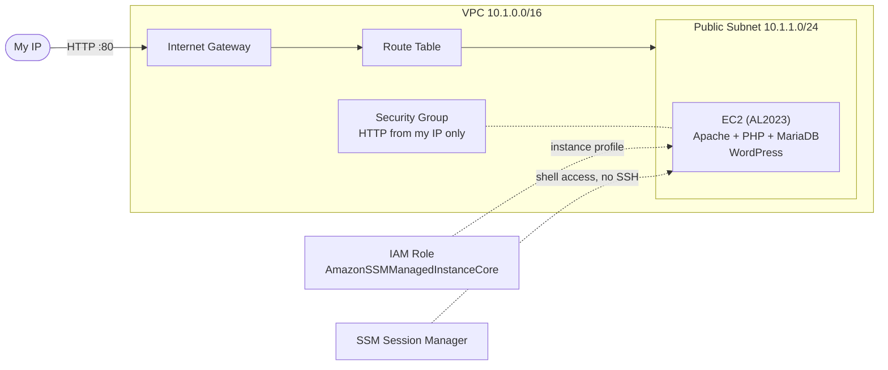
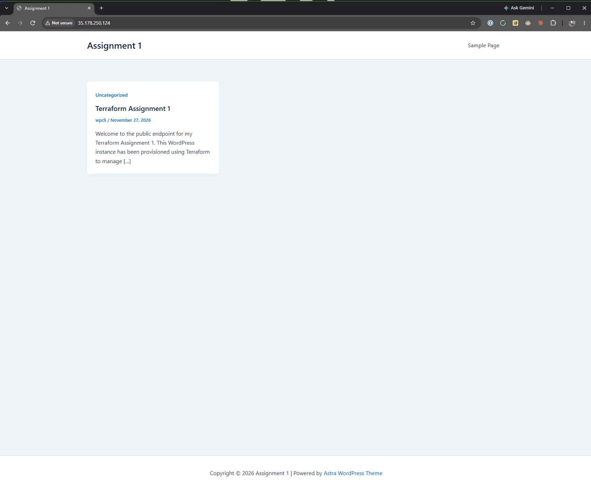
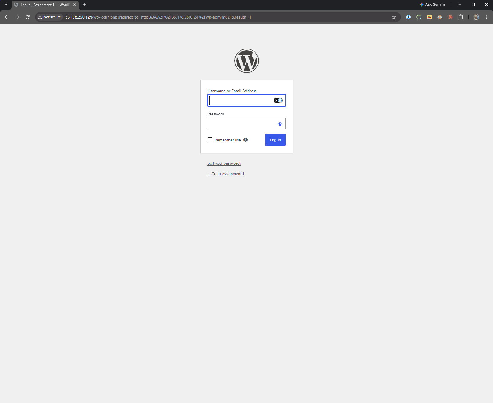

# Terraform Assignment 1 – WordPress on AWS
 
Deploys a WordPress site on EC2 with Terraform. The VPC, IAM and instance are all defined in code, and the site installs itself at first boot.
 
## Architecture
 

 
## Structure
 
```
.
├── main.tf               # wires the modules together
├── variables.tf
├── outputs.tf
├── terraform.tfvars      # gitignored – your values
└── modules/
    ├── network/          # VPC, IGW, route table, subnet, security group
    ├── iam/              # SSM role + instance profile
    └── ec2/              # instance + user data template
        └── templates/user_data.sh.tftpl
```
 
## How it works
 
1. **network** builds a VPC with one public subnet. The security group only allows HTTP from my IP.
2. **iam** creates a role with the SSM managed policy. The instance can be reached through Session Manager, so there's no port 22 and no key pair.
3. **ec2** launches the instance. User data is rendered with `templatefile()` and does the setup on first boot:
   - installs the LAMP stack and secures MariaDB
   - creates the WordPress database and user
   - downloads WordPress and writes `wp-config.php`
   - gets the instance's public IP from IMDSv2
   - completes the install with WP-CLI, sets the theme and the first post
## Usage
 
```bash
cp terraform.tfvars.example terraform.tfvars   # fill in your values
terraform init
terraform apply
```
 
Wait a few minutes for user data to finish, then open the public IP from the outputs.
 
```bash
terraform destroy
```
 
## Screenshots
 


 
## What I'd change for production
 
- **Secrets:** fetch DB passwords from SSM Parameter Store at boot instead of passing them through user data, which ends up in state and instance metadata.
- **Database:** move to RDS in private subnets, so the instance can be replaced without losing data.
- **HTTPS:** add an ALB with an ACM certificate on my domain.
- **Remote state:** store state in an S3 backend with locking.
- **Baked AMI:** build the image with Packer so boot doesn't install packages.
## What I learned
 
- First understanding the click-ops to configure infrastructure to better understand how to code it
- Refactoring a flat config into modules, and using `moved` blocks so state follows the code
- Module inputs and outputs: sibling modules don't call each other, the root wires them together
- `templatefile()` escaping (`$${}` for bash variables) and keeping secrets out of Git
- Writing non-interactive user data, e.g. replacing `mysql_secure_installation` with SQL
 